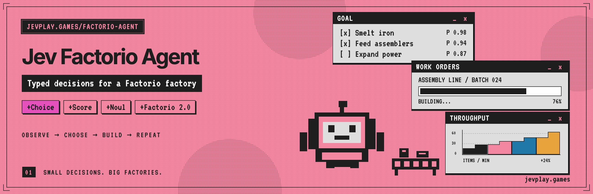
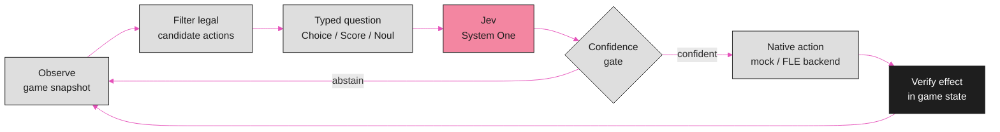

<p align="center"></p>

<div align="center">

# Jev Factorio Agent

**A Factorio agent in which Jev chooses goals and actions as typed questions while deterministic code owns game rules and actuation.**


[Quick start](#quick-start-offline-no-key-no-game) · [How it works](#how-it-works) · [Live Factorio](#live-factorio) · [Hierarchical controller](#hierarchical-controller-opt-in) · [Docs](docs/ARCHITECTURE.md) · [Engineering log](docs/ENGINEERING_LOG.md)

</div>

---

> [!NOTE]
> **Shipped:** the offline mock loop, the flat and hierarchical controllers, the
> dedicated-world FLE adapter, research logging, the campaign supervisor and the
> read-only dashboard. CI runs the unit suite on Python 3.10, 3.12 and 3.13 plus
> an offline hierarchical smoke run with sealed research evidence.
> **Not measured live:** no complete native rocket-launch playthrough is verified,
> and the experimental extensions in the [engineering log](docs/ENGINEERING_LOG.md)
> are source integrations whose native throughput benefit has not been measured.
> **Upstream:** this project derives from `Adibrill1/jev-factorio`, which publishes
> no license file; see [License and attribution](#license-and-attribution).

## Quick start (offline, no key, no game)

```bash
python -m venv .venv && source .venv/bin/activate
pip install -e .
PYTHONPATH=src python -m jev_factorio --backend mock --steps 8 --tick-seconds 0
```

With a real key (`TYPESAFE_API_KEY` in the environment) the same loop calls
`jev-latest` at `https://api.typesafe.ai/v1/systemone`.


## How it works

Jev (TypeSafe AI's System One model) makes the fast macro decisions - goal, next
action, stuck detection - as typed Choice/Score/Noul questions; deterministic
code owns game rules, option filtering, and actuation. To our knowledge this is
the first Jev-driven game agent.



Docs: [Architecture](docs/ARCHITECTURE.md) · [Build plan](docs/BUILD_PLAN.md) ·
[Latency attribution](docs/LATENCY_ATTRIBUTION.md). For bounded native runs with
error-triggered Codex repair and guarded relaunch, see
[Autonomous campaign supervision](docs/AUTONOMOUS_SUPERVISION.md).

## Local configuration

The CLI loads `.env` from the current working directory before reading settings.
Run from the repository root and set `TYPESAFE_API_KEY` in that file.
Exported environment variables take precedence. `.env` is ignored by Git;
keep its permissions restricted (`chmod 600 .env`) and never commit credentials.
Re-run `pip install -e .` after updating to install the dotenv dependency.

`--backend mock` simulates the game but still uses a configured API key.
For a fully offline run, override all provider credentials:

```bash
TYPESAFE_API_KEY= CLOUDFLARE_API_TOKEN= PYTHONPATH=src python -m jev_factorio --backend mock --steps 8 --tick-seconds 0
```

## Research logging (opt-in)

`--run-dir` (or `JEV_RUN_DIR`) creates a new exclusive evidence directory with a
secret-safe manifest, fsynced SHA-256-chained lifecycle events, and a final seal.
It never reuses an existing directory. The original `--log-file` remains
independently optional and retains its existing decision JSONL format.

```bash
python -m jev_factorio --controller hierarchical --backend mock --mock-model \
  --target bootstrap_mining --steps 40 --tick-seconds 0 \
  --run-dir runs/research-001 --log-file runs/research-001/decisions.jsonl
python -m jev_factorio.research_log runs/research-001
```

Controller call boundaries additionally record causal observations, decisions,
actions, verification, and attempt joins; see [causal logging](docs/CAUSAL_LOGGING.md).
This evidence is not a complete native action
trace. A valid seal proves internal consistency, not successful gameplay or
independent authenticity. See [Research logging](docs/RESEARCH_LOGGING.md) for
schemas, verification, incomplete runs, redaction and durability limits. Use a
new directory for each invocation; supervisor directory rotation is not yet
implemented, so do not export a fixed `JEV_RUN_DIR` to a supervised campaign.
An opt-in [owner step gate](docs/OWNER_STEP_GATE.md) can keep one resumed native
process alive across a bounded number of individually reviewed steps; it does
not authorize a live controller without the existing owner and native checks.


## Live Factorio

Install the optional adapter with `pip install -e '.[fle]'`. Configure the
`FACTORIO_RCON_*` variables in `.env` and keep the RCON connection private.
Only use a dedicated, disposable agent world: starting the adapter resets
characters, inventory, and factory entities. It refuses to start unless that
world has been explicitly marked through RCON:

```lua
/sc storage.jev_factorio_session = true
```

Save the marked world before starting the adapter, and configure the server to
load that save on restart. Never mark a personal gameplay world.

```bash
.venv/bin/python -m jev_factorio --backend fle --steps 12 \
  --tick-seconds 2 --log-file runs/native.jsonl
```

This bootstrap gathers coal, places an iron drill and output chest, and fuels
production. Player actions use native walking and mining states at 1× speed.
Buildings consume existing cursor items through ordinary build checks; transfers
require native interaction reach. FLE's teleporting movement, scripted harvesting,
and connection-building shortcuts are not used.
Decision logs distinguish Jev choices from confidence-gated scripted fallbacks.
FLE's executable Lua state stays in a session-only table, not Factorio's saved
`storage`, so saving does not try to serialize functions. Saved factories persist,
but the agent session does not resume across server reloads; starting another run
resets the dedicated world again. Keep the viewer connected before initializing
the agent; reconnecting viewers during a session is not yet validated.

Native actions select player 1 by default. An integration adopting an existing
connected character can set `jev_fle_runtime.jev_player_index` to a positive
integer before loading the native action modules. The logical FLE agent slot
`jev_fle_runtime.agent_characters[1]` must still identify that character. This is
an internal runtime setting, not a CLI option. The first module load locks the
selection for that runtime; changing it or selecting a different player on
reattachment fails closed. Cleanup stops the originally selected character, and
the adapter does not fall back to another connected player.

To continue a live agent session for 12 hours instead of a fixed number of steps:

```bash
.venv/bin/python -u -m jev_factorio --backend fle --resume \
  --duration-hours 12 --tick-seconds 2 --log-file runs/12-hour.jsonl
```

`--resume` refuses to reset if the live session is missing. Duration mode stops
starting decisions at its monotonic deadline; an in-flight decision may finish
afterward. It makes ongoing API calls and remains limited to the bootstrap
actions above, not full-game progression.

## Hierarchical controller (opt-in)

The [hierarchical controller guide](docs/HIERARCHICAL_CONTROLLER.md) describes
persistent goals, batched Jev candidate evaluation, verified skill plans,
checkpoint recovery, and deterministic comparison runs.

The [performance investigation prompt](docs/PERFORMANCE_INVESTIGATION_PROMPT.md)
defines a persistent, evidence-backed optimization study with an explicit PR approval gate.

```bash
python -m jev_factorio --controller hierarchical --backend mock --mock-model \
  --target bootstrap_mining --steps 40 --tick-seconds 0 \
  --checkpoint runs/bootstrap-state.json --log-file runs/bootstrap.jsonl
```

The FLE hierarchical controller now compiles native production and research
plans for `iron_smelting`, `steam_power`, `automation_science`, and `rocket_launch`.
It reads recipes, technology costs, and machine capabilities from the running
base game rather than assuming fixed research costs. The existing flat controller
stays the default and remains bootstrap-only.

```bash
python -m jev_factorio --controller hierarchical --backend fle --resume \
  --target rocket_launch --policy hybrid --duration-hours 12 \
  --checkpoint runs/campaign-state.json --log-file runs/campaign.jsonl
```

`hybrid` records Jev abstentions and uses a deterministic compiled plan when
needed; `jev` remains strict. The agent carries solids between machines and builds
physical fluid and electricity connections. Native crafting, inventories,
research, and the force rocket-launch counter verify progress. Movement and
resource gathering use tick-driven native walking and mining through the fair
action layer, with original-player binding and normal interaction reach checks.
The controller issues these actions through FLE/RCON rather than keyboard/mouse
input; it still carries solids between machines rather than automating every haul.

For an authorized hierarchical campaign without a step or duration cutoff, use
`--until-complete`:

```bash
python -m jev_factorio --controller hierarchical --backend fle --resume \
  --target rocket_launch --policy hybrid --until-complete --tick-seconds 2 \
  --checkpoint runs/campaign-state.json --log-file runs/campaign.jsonl
```

This mode requires the hierarchical controller's durable target state. It stops
when that target is verified or the controller reaches its existing `blocked`
or `uncertain` terminal state; those two states are not successful completion.
Unexpected API, observation, dispatch, and persistence failures still propagate
through the existing recovery guards. No retry policy is added. The default
step limit and `--duration-hours` mode remain bounded.

For a checkpoint blocked specifically by `Candidate evidence insufficient` or
`low choice confidence`, `--reevaluate-blocked-once` authorizes one fresh
decision after the decision contract changes. No other blocked reason is
eligible. It also requires `--resume --resume-controller`, the exact checkpoint
SHA-256, and the full source revision that recorded the block. The source
revision is an explicit checkpoint-owner pin; a legacy checkpoint does not
contain enough metadata to infer it. The pinned source must be an ancestor of
the clean current checkout, whose decision-contract content must have changed.
This authorization is consumed durably before model selection and cannot be
replayed for the same contract. The checkpoint must be quiescent: no pending
work and no half-written background record. A tracked background craft job with
its attempt record is allowed (the controller verifies it on every
observation), and a persistent-recovery block, identified by its durable
recovery ledger, is eligible below the stalled-decision threshold because it is
written at the first exhausted decision frontier. The existing stalled-decision
counter, block history, and failure history are preserved. If a plan is selected, the
requested run mode continues normally, including `--until-complete`; a rejected
decision remains blocked and increments the existing streak. It does not clear
the block, reset counters, or authorize a second controller. Do not combine it
with reconcile-only or owner-step gating.

For an explicitly authorized, no-cutoff campaign that should keep observing
after a recoverable decision block (including `model abstention`), add
`--persist-recoverable-blocks` to `--until-complete`. The first blocked
checkpoint still needs the exact changed-contract authorization above. The
controller keeps the blocked status and failure/stall history, records each
source-bound decision fingerprint before a model request, and waits for changed
native decision evidence before another request. A new game tick or a planned
receipt containing only that tick does not trigger another request; inventory,
production, research, native receipts, candidate evidence, or an absolute
native deadline change can. Waits grow from two seconds to five minutes and
perform observation only. No action, confidence gate, receipt rule, or budget
is bypassed, and progress still requires the existing native verification.
If the process stops after saving a request fingerprint but before committing its
model outcome, the next resume marks the evaluation outcome unknown and continues
observing; it never repeats that same request fingerprint.
Persistent recovery defaults to observation-only waiting without an idle cutoff
(`--persistent-idle-observations 0`). The same controller retains its original lock,
checkpoint, blocked decision history and budgets; it does not repeat an unchanged
model request or dispatch an unsupported action. Delays still back off to 300 seconds.
An operator may explicitly set a positive idle-observation limit. After that many
maximum-delay observations with unchanged resolved evidence, the invocation ends
with `idle_wait_exhausted`, preserving its blocked checkpoint. A finite configured
limit remains process-local; it is not goal completion. The
invocation exits normally in this case, but that is not success: the campaign is still
blocked, and a launcher must not treat the exit as completion. An
unresolved evaluation outcome is never abandoned by this bound.
Provider, native, checkpoint, or owner-gate faults stop through the normal
failure path. The mode requires resumed live FLE Jev control, a supervisor-pinned
source revision, the existing external single-owner lock, and an operator-owned
run window; it does not extend that window.

The persistent attempt checkpoint keeps a bounded active tail of 1,024
fingerprints. At a quiescent decision boundary, older rows are written unchanged
to immutable, content-addressed segments in the checkpoint's sibling archive
directory; the checkpoint pointer and hash chain remain the authority for
which segments are committed. Startup validates the referenced chain before
backend attachment, and each duplicate lookup rechecks archive-directory and
segment identities before consulting its bounded disk index. Missing, changed,
or unreadable archive data stops recovery rather than dropping history or
resetting the attempt budget. Rotation uses the existing one-gigabyte storage
reserve and preserves pending outcomes as ambiguous, so an archived request is
never replayed just because the active tail was rotated.

The route-cache regression tests replay the exact decision-fingerprint paths.
Offline review also replayed a captured 15-event request slice. That slice is partial and not a
sealed campaign report; it cannot establish total-run call reduction or gameplay
benefit. In the slice, route-cache timestamps and the `cached` flag alone
collapsed to one fingerprint, while later request states also differed as older
verified history entries left the bounded prompt window. History remains part of
the decision input and is not discarded by this change. A cache-only wait does
not issue another model request, so it does not keep evicting history through
repeated polling.

When current research planning identifies a paid `utility:lab` placement as the
immediate prerequisite for a capability technology, the decision evidence
binds that prerequisite to the current technology plan, carried lab, absent lab
role, and connected, bound, idle actor. It does not claim a clear placement
site, successful travel or arrival, lab power, or completed research. The
existing placement action performs a bounded native site search and fresh build
checks at dispatch; only its native result and a fresh role observation can
verify placement. Power and research need later native verification.

**Experimental: no complete native rocket-launch playthrough is verified.**
Native hand-crafting requires a connected viewer controlling the agent character.
Live-session resume does not support server reloads or viewer reconnection;
do not reset the world or discard a pending checkpoint to work around a failure.
The implementation is restricted to the exported Factorio 2.0 base-game catalog;
unsupported mods, recipes, or bounded exploration failures stop explicitly.


## Repository layout

```text
jev-factorio-agent/
├── src/jev_factorio/
│   ├── state.py            # GameSnapshot + compact Jev-facing state
│   ├── questions.py        # typed question builders + candidate-action filter
│   ├── jev_client.py       # SDK/HTTP client + offline MockJevClient
│   ├── loop.py             # observe -> ask -> gate on confidence -> act
│   ├── controller.py       # hierarchical controller
│   ├── supervisor.py       # autonomous campaign supervision
│   ├── dashboard.py        # read-only local dashboard (dashboard_assets/)
│   ├── backends/           # mock, dedicated-world FLE adapter, play_api (skeleton)
│   ├── planning/           # goals, production, research and service planning
│   └── lua/                # native Factorio-side modules used through RCON
├── tests/                  # pytest suite and fixtures
├── docs/                   # architecture, runbooks and the engineering log
├── benchmarks/             # offline benchmarks
├── scripts/                # PR reference check, OBS launcher, checkpoint benchmark
└── assets/                 # banner, social preview and their HTML sources
```

## Contributing

1. Create a virtual environment and install the test extras:
   `python -m pip install -e '.[test]'`.
2. Run `python -m pytest tests/ -q` before opening a pull request. Dashboard
   browser tests need `pip install -e '.[dashboard-test]'` and
   `python -m playwright install chromium`.
3. Fill in the [pull request template](.github/pull_request_template.md):
   separate source, fixture and native gameplay evidence, and use `Refs #...`
   for related open work. Never use negated closing phrases; CI rejects them.
4. Read [AGENTS.md](AGENTS.md) before touching live runs, supervisors or the
   stream overlay.

## License and attribution

MIT - see [LICENSE](LICENSE). Copyright (c) 2026 Timothy Gregg, CompleteTech LLC.

This project derives from `Adibrill1/jev-factorio`, which publishes no license
file. The MIT grant here covers CompleteTech's own additions and modifications;
confirm the upstream terms with that project's author before reusing the
inherited skeleton elsewhere.

---

<p align="center">
<sub>A jevplay.games project · Steward: CompleteTech LLC · MIT licensed<br>
Not an official TypeSafe AI publication; the pink, ink and pixel-window styling is a nod to <a href="https://typesafe.ai">typesafe.ai</a>. Jev, System One and TypeSafe are their respective owners' names. Factorio is a trademark of Wube Software; this project isn't affiliated with Wube.</sub>
</p>
